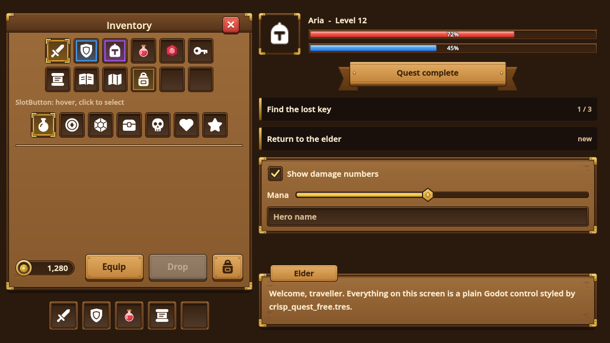

# Crisp Quest Free Theme

A carved-wood fantasy RPG UI theme with brass corner brackets. One Godot 4 `Theme` resource styles the standard controls -
buttons, check boxes, sliders, health bars, text fields, panels, separators, item lists, tooltips - and adds type variations
for a window, dialogue box, inventory and hotbar slots, rarity borders, a mana bar, quest rows and more. It comes with the
52 PNG pieces it is built from (34 Carved Wood pieces, 15 white icons, 3 colour icons), each at 1x and 2x.
It is the free sampler of [Crisp Quest](https://anipixels.itch.io/crisp-quest).



## Install

**From the Asset Library (inside Godot):** open the **AssetLib** tab, search for "Crisp Quest Free Theme", press **Download**, then **Install**.
Everything lands in `res://addons/crisp_quest_free/`.

**By hand:** download this repository (or `git clone` it) and copy the `addons/crisp_quest_free` folder into your project,
so that it sits at `res://addons/crisp_quest_free`. The scenes and resources point at that path, so keep the folder name.

To try the demo, open `res://addons/crisp_quest_free/demo/quest_free_demo.tscn` and press **Run Current Scene** (F6).
A `git clone` of this repository also opens as a Godot project of its own and runs the demo with F5
(zip downloads leave `project.godot` out on purpose, so they contain only the `addons/` folder).

## Use

```gdscript
# Whole project: Project Settings > GUI > Theme > Custom = res://addons/crisp_quest_free/crisp_quest_free.tres
# Or one branch of the UI, from code:
$Hud.theme = preload("res://addons/crisp_quest_free/crisp_quest_free.tres")

$Hud/Mana.theme_type_variation = &"ProgressBarMana"    # extra shapes are type variations
$Hud/Bag/Slot1.theme_type_variation = &"SlotRare"      # a PanelContainer, 48 x 48, with a 32 px icon inside
```

`crisp_quest_free.tres` uses the 1x textures. The pieces are drawn for layouts of about 960 x 540 to 1280 x 720; slots are 48 px and icons 32 px at 1x. For 1080p-and-up or HiDPI layouts use
`crisp_quest_free_2x.tres`, which is the same theme built on the 2x textures with every size doubled.
Fixed-size pieces (noted below) do not stretch: give those nodes the stated minimum size, doubled for the 2x theme.

## What the theme covers

| Control / type | What it gets | Pieces used |
|---|---|---|
| `Button` (and `OptionButton`, which inherits it) | normal, hover, pressed, disabled | `button_medium_*` (all four states) |
| `CheckBox` | checked / unchecked icons | `checkbox_on`, `checkbox_off` |
| `ProgressBar` | frame and red fill | `bar_frame`, `bar_fill_health` |
| `HSlider` | track, filled part, knob | `slider_track`, `slider_fill`, `slider_knob_normal` |
| `LineEdit`, `TextEdit` | field background | `input_normal` |
| `Panel`, `PanelContainer` | wood panel with brass corners | `panel` |
| `HSeparator` | brass divider line | `divider` |
| `ItemList` | inset panel, row highlight | `panel_inset`, `list_row` |
| Tooltips (`TooltipPanel`, `TooltipLabel`) | dark box, cream text | `tooltip` |
| `Label` | cream text for the wood panels | - |

Type variations (set **Theme > Type Variation** on the node):

| Variation | Base | Notes |
|---|---|---|
| `ButtonSquare` | Button | square icon button (52 x 52 looks right) |
| `ButtonClose` | Button | red close button. Fixed-size art: give the node a size of 32 x 34 |
| `SlotButton` | Button | clickable inventory slot: hover highlight, selected frame when pressed (use `toggle_mode`); 48 x 48 |
| `ProgressBarMana` | ProgressBar | the same bar with the blue fill |
| `Slot`, `SlotHover`, `SlotSelected`, `SlotRare`, `SlotEpic` | PanelContainer | 48 px inventory slots; put a 32 px icon inside |
| `HotbarSlot` | PanelContainer | 56 px hotbar slot |
| `WindowPanel` | PanelContainer | window with a title bar (36 px); put a `LabelTitle` over it |
| `DialogBox`, `NamePlate` | PanelContainer | dialogue box and the name plate that overlaps its top-left corner |
| `PanelInset` | PanelContainer | dark sunken area |
| `Ribbon` | PanelContainer | title ribbon, fixed height 56 |
| `CurrencyPlate` | PanelContainer | gold counter with a socket for a 20 px icon on the left, fixed height 32 |
| `QuestEntry` | PanelContainer | semi-transparent quest-tracker row |
| `ListRow` | PanelContainer | list row |
| `TooltipBox` | PanelContainer | the tooltip box as a normal container |
| `PortraitFrame` | PanelContainer | hollow 80 px portrait frame |
| `LabelTitle` | Label | cream title text with a shadow, for the window title bar |
| `LabelOnAccent` | Label | dark text for the light wood of buttons, ribbons and name plates |
| `LabelMuted`, `LabelTooltip` | Label | small secondary text |

## What it does not cover

Only pieces that exist in the free sampler are used, so some controls are left alone on purpose:

- **CheckButton (switch), radio buttons, tabs, scroll bars, popup menus / dropdown lists, trees, spin boxes, vertical sliders, vertical
  separators**: the sampler has no pieces for them. `CheckButton` gets the text colours only and keeps Godot's default switch icon;
  the rest keep Godot's default look. (A `CheckBox` in a `ButtonGroup` shows Godot's default radio icon.)
- **Hover / disabled art for `ButtonSquare` and `ButtonClose`, a hover knob for the slider, a "selected" list row**: not in the sampler.
  Hover looks like normal, pressed `ButtonClose` darkens the art, disabled ones are the normal art faded, and `ItemList` uses
  `list_row` for the selected row and a faded `list_row` for the hovered one.
- **Focus art**: keyboard focus is drawn as a plain 2 px gold outline (a `StyleBoxFlat`, not one of the pack's pieces). Text fields have
  no separate focus or read-only art; read-only is the normal field faded.
- **Font**: none is bundled and no piece has lettering baked in. The theme emboldens whatever font the project uses (Godot's default if
  you set none). A bold serif such as Cinzel, Alegreya or EB Garamond suits it.
- **Other materials**: Carved Wood only.

## What is in it

110 files, 242 KB. The 104 PNGs are the sampler's pieces at 1x and 2x (52 each); the icons and prompts are not part of
the Theme but are there for your buttons and HUD (see the demo scene).

- `./` - `LICENSE.txt`, `README.md`, `crisp_quest_free.tres`, `crisp_quest_free_2x.tres`
- `demo/` - `quest_free_demo.gd`, `quest_free_demo.tscn`
- `textures/1x/icons_colour/` - `coin_gold.png`, `gem_ruby.png`, `potion_red.png`
- `textures/1x/icons_white/` - 15 files (.png)
- `textures/1x/wood/` - 34 files (.png)
- `textures/2x/icons_colour/` - `coin_gold.png`, `gem_ruby.png`, `potion_red.png`
- `textures/2x/icons_white/` - 15 files (.png)
- `textures/2x/wood/` - 34 files (.png)

## Full pack

**[Crisp Quest on itch.io](https://anipixels.itch.io/crisp-quest)** has **135 pieces in each of 6 material themes** (Carved Wood, Parchment & Ink,
Stone & Iron, Royal Gold, Elven Silver, Arcane - different drawings, not recolours), **147 fantasy icons** in white and dark and
**37 colour icons** - 1141 images (3423 files as PNG 1x, PNG 2x and SVG). Its Godot themes cover what this one cannot: every
button size with all four states, switch and radio art, tabs, scroll bar, dropdown list, all five rarity borders, equipment
slots, cooldown overlays, orbs, stamina and experience bars, focus and disabled art, and a theme per material.

## Godot version

Written for **Godot 4.3 and newer** (GDScript only, no C#, no GDExtension, no feature known to need 4.4 or later).
Tested on **Godot 4.7.2 stable (the .NET editor build, run headless on Windows 11)**: headless import plus a script that loads every file and exercises the public API,
with no errors or warnings. It has **not** been run on 4.3 - 4.6; if something misbehaves there, please open an issue.

The demo scene was also rendered once in a real window to make `screenshot.png`; individual hover, pressed and focus states
were checked by loading, not by eye.

## Licence

This free repository has two licences, both standard and both fine for commercial games:

- **Assets** - the images (PNG), Theme resources (.tres) and the demo scene (.tscn) - are under **Creative Commons Attribution 4.0 International (CC BY 4.0)**.
  Use, edit and ship them in anything, including commercial projects, as long as you give credit.
  A line like this in your credits is enough: `Crisp Quest Free Theme by Anipixels - https://anipixels.itch.io/crisp-quest`
- **Code** - every `.gd` file - is under the **MIT licence**.

See `LICENSE` (assets) and `LICENSE-CODE` (code); a copy of both is in `addons/crisp_quest_free/LICENSE.txt`.
This applies to the files in this repository only. The paid full pack has its own licence (no attribution needed, no redistribution).

## How it was made

The images are generated procedurally by code written with an AI assistant (Claude). No AI image or audio generators were used, and nothing is traced or taken from third-party assets.
